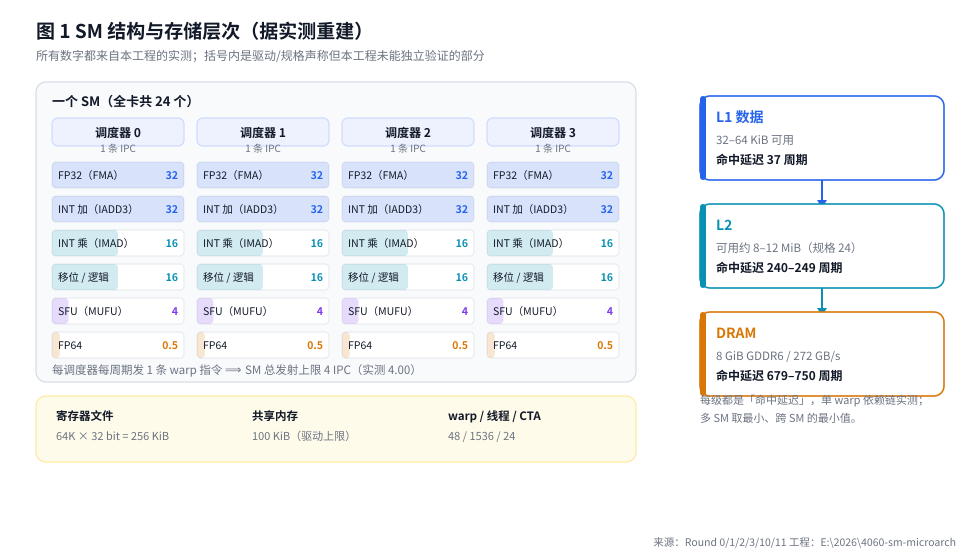
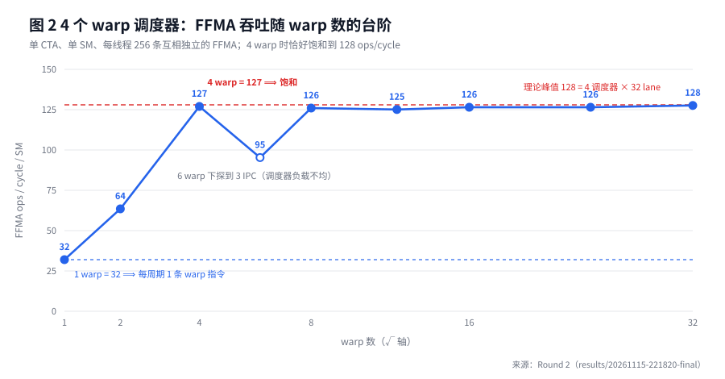

# RTX 4060 SM 微架构逆向（Ada Lovelace / AD107 / sm_89）

用**微基准测量**反推这块 RTX 4060 的 SM 内部结构：几个 warp 调度器、每条流水线多宽、
每条指令多少周期、寄存器/共享内存/L2 有多大。

> **🌐 在线阅读：[huangxc6.github.io/rtx4060-sm-microarch](https://huangxc6.github.io/rtx4060-sm-microarch/)**
> ｜ **📦 [Release v1.0](https://github.com/huangxc6/rtx4060-sm-microarch/releases/tag/v1.0)**（可直接下载报告）
>
> **📄 发布版报告：[`docs/final-report.html`](docs/final-report.html)**
> （单文件自包含，12 张 SVG 内联，可直接打开 / 打印 / 转发）
> 源文件 [`docs/FINAL-REPORT.md`](docs/FINAL-REPORT.md)，
> 图表由 [`docs/figures/make_figures.py`](docs/figures/make_figures.py) 用代码生成。

不抄规格书。每个结论都必须有「内核内实测周期数 + SASS 反汇编证据 + 可证伪的检验」三件套，
没有证据的数字在报告里会被明确标成「待验证」。





```
GPU      NVIDIA GeForce RTX 4060   (Ada Lovelace / AD107, compute 8.9, sm_89, 8 GiB)
宿主     Windows 11 26200 / i5-13490F / 32 GB
驱动     610.88 (KMD 610.88, CUDA UMD 13.3), WDDM, 非管理员
工具链   无 CUDA Toolkit、无 MSVC/clang —— 全部免安装（见下）
```

## 快速开始

```powershell
git clone <this-repo> && cd rtx4060-sm-microarch

# 1) 装工具链（约 100 MB 下载；无需管理员、无需 CUDA Toolkit）
powershell -ExecutionPolicy Bypass -File scripts\bootstrap.ps1

# 2) 跑测量（13 轮，约 14 分钟）
powershell -ExecutionPolicy Bypass -File scripts\run_all.ps1

#    或只跑某几轮
.\.venv\Scripts\python.exe run_all.py --round 2 3
.\.venv\Scripts\python.exe run_all.py --round 3 --tag mem

# 3) 重新生成报告
.\.venv\Scripts\python.exe docs\figures\make_figures.py
.\.venv\Scripts\python.exe docs\make_html.py
```

输出两份文件：`results/<ts>/run.log`（人读）与 `results/<ts>/results.json`（机读，
含每个探针的全部原始数值与 SASS 证据行）。

**完整复现步骤、前置条件、已知的环境限制见 [`REPRODUCE.md`](REPRODUCE.md)。**

## 目录

```
harness/            测量框架（只依赖 Python 标准库 + ctypes）
  cuda.py           纯 ctypes 的 CUDA 驱动 API + NVRTC 绑定
  env.py            DLL 搜索路径、设备属性、显存
  jit.py            NVRTC 编译、模块加载、cuobjdump/nvdisasm 反汇编
  bench.py          周期计时（clock64）、预热、差值法
probes/             各轮探针，每个模块暴露 run(log, reps) -> dict
  round0.py         设备事实 / 实测主频 / 硬件自报 SM 普查 / 占用率上限
  round1_latency.py 指令延迟（串行依赖链）
  round2_throughput.py 指令吞吐与发射宽度（warp 数扫描）
  round3_memory.py  存储层次：指针追逐 / smem bank / 带宽 / sector
  round4_scheduler.py 调度器行为（per-warp 计时）与总发射宽度
  round5_tensor.py  Tensor Core：FP16/TF32/FP8 的 MMA 吞吐与延迟
  round6_sparse_dispatch.py 稀疏 MMA 与 warp 启动时序
  round7_bank_agg.py 操作数供给模式与多 CTA 扩展性
  round8_bankfit_dispatch.py warp 发射速率与 bank 结构统计拟合
  round9_int_tensor_tlb.py INT8/INT4 张量与 TLB
  round10_noise_multism.py 干扰量化与多 SM 降噪
  round11_l2_capacity.py L2 容量拐点
  round12_icache.py L1I 容量 / L0I 分区争用
  round13_icache_struct.py 自建步进引擎：容量 / 预取 / 替换
scripts/            免管理员工具链准备与运行包装
  bootstrap.ps1     下 nvrtc/cuobjdump/nvdisasm 并自检
  run_all.ps1       跑测量（顺带设好控制台编码）
docs/
  FINAL-REPORT.md   ★ 发布版报告（源）
  final-report.html ★ 发布版报告（自包含 HTML，SVG 内联）
  figures/          12 张 SVG（由 make_figures.py 代码生成）
  make_html.py      MD -> 自包含 HTML
  00-methodology.md 测量方法论与踩坑记录
  01-device-facts.md Round 0 实测数据
  02-sm-microarch.md SM 微架构逆向结论 ← 主文档
  03-roadmap.md     下一步（稀疏 MMA、寄存器 bank 冲突、warp→调度器规则、TLB）
  04-memory-hierarchy.md 存储层次：L1/L2/DRAM、smem bank、带宽、sector
  05-tensor-core.md 第 4 代 Tensor Core：FP16/TF32/FP8 吞吐与延迟
  06-sparse-and-dispatch.md 稀疏 MMA 与 warp 启动/分配行为
  07-operand-supply-and-scaling.md 操作数供给（三源全不同 → 78）与多 CTA 扩展性
  08-warp-dispatch-and-bank-fit.md warp 发射速率与寄存器 bank 结构的统计拟合
  09-int-tensor-and-tlb.md INT8/INT4 张量与 TLB
  10-noise-and-multism.md 桌面干扰量化与多 SM 降噪法
  11-l2-capacity.md L2 容量拐点
  12-l1i.md        L1I / L0I（移植 icache_b300_pkg）
  13-icache-structure.md 指令缓存容量 / 预取 / 替换（自建引擎）
notes/
  inference-log.md  逐条结论的证据链（测量 / SASS / 反证 / 置信度）
results/            11 份原始数据快照：文档引用过的 8 份 + 最新全量 + round11/12
build/              工具与临时产物（tools/ 是解压的 nvdisasm/cuobjdump）
smoke.py            链路自检
diag_smem.py        诊断脚本：查 LDS 语句为何在 SASS 里消失（保留作为踩坑证据）
run_all.py          总入口
```

## 工具链：为什么一个都装不上，却全都能用

这台机器**没有** CUDA Toolkit，**没有**任何 C/C++ 编译器（`cl`/`gcc`/`clang`/`cmake` 全缺），
而且 DSH 会话非管理员，装不了 3 GB 的 Toolkit。于是全部走免安装路线：

| 需要的东西 | 解决方案 |
|---|---|
| 编译 CUDA C++ | pip wheel `nvidia-cuda-nvrtc-cu12` 里的 `nvrtc64_120_0.dll`（手工解压，见下） |
| 加载/启动内核 | `cuda.dll`（`nvcuda.dll`）用 **纯 ctypes** 直调驱动 API，不装 `cuda-python` |
| 看 SASS | NVIDIA redist 的独立 zip：`cuda_nvdisasm` / `cuda_cuobjdump`，解压即用，无需安装 |
| 读 GPU 计数 | 驱动自带的 `nvidia-smi`（只用于环境注脚，不用于测时） |

两个踩坑点（都已绕过，写在这里省得下次重踩）：

1. **这台机器的 pip 会卡死**：解析阶段 CPU 占满但几十分钟不动（镜像直连实测有 1.4 MB/s，
   说明不是网速问题）。所以 wheel 是用 `Invoke-WebRequest` 直接下的，再用
   `[System.IO.Compression.ZipFile]` 解压进 `.venv/Lib/site-packages`。
2. **nvrtc 的 wheel 不含 `cuda_runtime.h`**：所以所有测量内核都只用编译器内建
   （`threadIdx`/`blockIdx`）与内联 PTX，不 `#include` 任何头文件。这反而正合本工程的需要——
   测量指令序列必须逐条可控。

安装步骤（在新机器上复现）：

```powershell
# 1) nvrtc DLL（wheel 就是 zip，直接解压到 site-packages）
Invoke-WebRequest -Uri "https://pypi.tuna.tsinghua.edu.cn/packages/52/de/823919be3b9d0ccbf1f784035423c5f18f4267fb0123558d58b813c6ec86/nvidia_cuda_nvrtc_cu12-12.9.86-py3-none-win_amd64.whl" -OutFile nvrtc.whl
[System.IO.Compression.ZipFile]::ExtractToDirectory("nvrtc.whl", ".venv\Lib\site-packages")

# 2) nvdisasm / cuobjdump（NVIDIA redist 的独立 zip）
#    https://developer.download.nvidia.com/compute/cuda/redist/ 下的
#    cuda_nvdisasm/windows-x86_64/...archive.zip 与 cuda_cuobjdump/windows-x86_64/...archive.zip
#    解压到 build/tools/
```

## 核心方法（细节见 docs/00-methodology.md）

- **只信周期，不信纳秒**。无法锁频（非管理员），所以一切测量都用内核内的 `%clock64` 取周期数，
  再用 `%globaltimer`/`%clock64` 同步采样得到瞬时主频。得到的都是 `ops/cycle`、`cycles/op`
  这类与频率无关的固有量。
- **差值法**。同一内核取两个迭代数 N1/N2，`(C2-C1)/(N2-N1)`，消掉启动与 `clock64` 的固定开销。
- **按真实 SASS 条数归一**。ptxas 会做代数化简（实测：`a+=1` 重复 320 次被折成一条 `IADD3`，
  `a^=b` 两次自逆抵消，`rcp∘rcp` 是恒等）。所以吞吐一律用「两次不同轮数的 SASS 指令数之差」
  来归一，而不是源码条数——否则会测出 52428 ops/cyc 这种荒谬值。
- **预热**。每次测量前灌 250 ms 满载内核，把 GPU 从 P3（285 MHz）顶到 boost（实测 ~2.75 GHz）。

## 当前状态

| 轮次 | 内容 | 状态 |
|---|---|---|
| Round 0 | 设备事实、实测主频、硬件自报 SM 普查、占用率上限 | ✅ 完成 |
| Round 1 | 指令延迟（FFMA/FADD/FMUL/IMAD/IADD3/SHF/F2I/MUFU/HFMA2/DFMA） | ✅ 完成 |
| Round 2 | 指令吞吐与发射宽度（warp 扫描、FP32/INT32/FP16/SFU/FP64） | ✅ 完成 |
| Round 3 | 存储层次：L1/L2/DRAM 延迟、smem bank、带宽、sector 尺寸 | ✅ 完成 |
| Round 4 | 调度器行为（per-warp 计时）、总发射宽度（双发射判定） | ✅ 完成 |
| Round 5 | 第 4 代 Tensor Core：FP16 / TF32 / FP8 的吞吐与延迟 | ✅ 完成 |
| Round 6 | 稀疏 MMA（2:4）、warp 启动时序、per-warp 计时的可信度 | ✅ 完成 |
| Round 7 | 操作数供给（三源全不同 → 78 ops/cyc）、多 CTA 扩展性（直接测出 24 SM） | ✅ 完成 |
| Round 8 | warp 发射速率（32 warp 仅跨 30 周期）、寄存器 bank 拟合（倾向端口限制） | ✅ 完成 |
| Round 9 | INT8/INT4 张量（INT8 是 FP8 的 2×）、TLB（512 MiB 跨度内零代价） | ✅ 完成 |
| Round 10 | 桌面干扰量化（同测量 3.4×）、多 SM 取最小降噪法（消除 2–8 MiB 伪台阶） | ✅ 完成 |
| Round 11 | L2 容量拐点（夹在 8–16 MiB，可用容量约 8–12 MiB） | ✅ 完成 |
| Round 12 | L1I 容量（64–80 KiB）、L0I 分区争用（移植外部 icache 包） | ✅ 完成 |
| Round 13 | 指令缓存容量复核（54–64 KiB）、取指预取深度（1 行）、替换策略（未测出） | ✅ 完成 |

主结论见 [docs/02-sm-microarch.md](docs/02-sm-microarch.md)，
存储层次见 [docs/04-memory-hierarchy.md](docs/04-memory-hierarchy.md)。

## 一句话结论（详见报告）

> 这块 AD107 的 SM 是 **4 个调度器**：每调度器每周期发 1 条 warp 指令、管 32 个 FP32 lane，
> 于是 FP32 峰值 128 ops/cycle/SM、SFU 16、FP64 2（正好 1/64）。
> INT32 加能跑满 128 宽，而乘/移位/逻辑只有 64 宽；
> FFMA 延迟 4 周期、MUFU 17、FP64 48；每 SM 64K 寄存器 / 100 KiB smem / 24 MiB L2。
>
> 存储侧：L1 命中 **37 周期**、L2 命中 **230–265**、DRAM **737–849**（280–325 ns）；
> 显存带宽实测 **250 GB/s**（标称 272 的 92%）；**sector = 32 B**；
> 共享内存 **32 bank × 4 B**，峰值 128 B/cycle，LDS 延迟 **24 周期**。
>
> 发射侧：**每调度器每周期只发 1 条指令、没有双发射**（混合流实测 4.00 IPC）；
> Tensor Core：FP16 **514** / TF32 **257** / FP8 **1025** FLOP/cycle/SM，
> MMA 延迟约 **40 周期**，`wgmma` 在 sm_89 上不存在；
> 稀疏 MMA（`HMMA.SP.16832`）与 dense **同发射率**——等效 2×，但有用 FLOP 不翻倍。
>
> 两个限定：**「FP32 峰值 128」要求操作数可复用**（三源全不同时只有 **78** ops/cyc）；
> 全卡扩展性直接验证了 **24 个 SM**（grid 1→24 时间恒定、grid=25 翻倍），
> 全卡实测 15.1 TFLOPS（理想 16.86 的 89%）。
>
> 78 这个数的机制：bank 冲突模型全对不上（误差 18–64%），
> 「每 lane 只能供 2 次读」的端口模型预测 85.3 最接近（差 9.4%）——倾向端口限制。
>
> 指令缓存：L1I 容量 **64–80 KiB**，容量内 1.01–1.13 cycles/指令，越界 2.4×。
>
> 张量精度谱完整：INT8 **2047**、INT4 **4095** FLOP/cycle/SM；
> 同形状下 INT8 的发射率是 FP8 的 **2×**（FP8 疑似半速）。TLB 在 512 MiB 跨度内零代价。
>
> **数据质量**：桌面干扰让同一次测量在 3 秒内差 **3.4×**；
> 「多 SM 取最小」把它压到可接受范围，并证明 Round 3 那个 2–8 MiB「台阶」是伪像，
> 真实 L2 命中是 **240–249 周期**（≤8 MiB），**可用 L2 容量约 8–12 MiB**（规格 24 MiB，拐点在 8–16 MiB 之间）。
