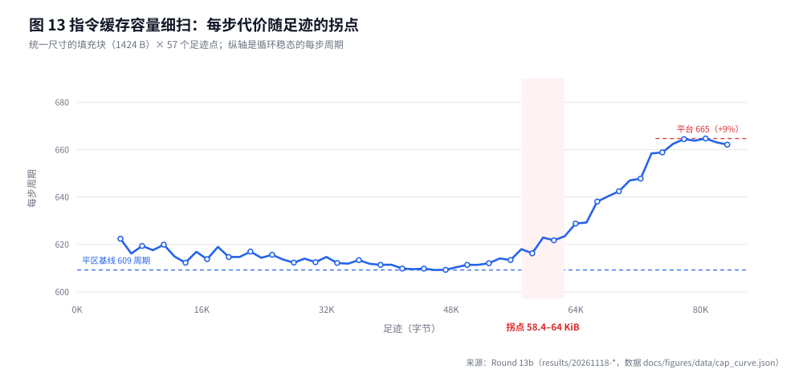

# Round 13：指令缓存的分级容量、预取与替换

数据来源：`results/20261118-212740/`（Round 13 单轮）。

---

## 0. 结论

| 项 | 实测 | 置信度 |
|---|---|---|
| **L1I 容量**（细扫 57 点） | 平区止于 **58.4–59.8 KiB**，64 KiB 时 +3%，**76 KiB 后稳定 +9%** | 高 |
| 命中 / 失效的单步代价 | **165 / 344 周期** | 高 |
| **指令预取** | **只预取相邻 1 行**：+1 行 181（≈命中）、+2 行 254、+3 行 272、+7 行 348（全失效） | 中高 |
| **替换策略** | **未定论**（单行循环 137 vs 8 行循环 220，区分不了 LRU/FIFO/随机） | 低 |
| **L0 / L1.5 的分级** | **未分离**（本轮的探针是单 warp，看到的是合成容量） | — |

**最重要的一条**：容量拐点用**完全独立的方法**（自建步进引擎 + 稳态差值）得到
**53.8–64.5 KiB**，与 Round 12 的 `fp` 足迹扫描（64–80 KiB）互相印证。
两条路都指向"L1I 大约 64 KiB"。

---

## 1. 为什么不用包里的 `seq` 族

`third_party/icache_b300_pkg` 的 `seq` 族设计得很完整（6393 个 segment、815070 步、
80 个 family，覆盖 L0/L1 容量、组相联、预取、替换、跨分区共享），但它用 **`brx.idx`**
做派发，且**内联 994 个分支目标**：

```
SASS:  BRX R14 -0x2e0  (*"BRANCH_TARGETS .L_x_8,.L_x_9,...
```

在 sm_89 + nvrtc 上这条指令**一执行就崩**：

| 实验 | 结果 | 说明 |
|---|---|---|
| `roles=0`（所有 warp 立即 return） | ✅ 正常 | 模块加载与启动没问题 |
| `seq_len=0`（一步都不走） | ❌ `CUDA_ERROR_ILLEGAL_ADDRESS` | 说明崩在**进入跳转表**那一下 |
| 块 id 范围 | 1..993，内核定义了 0..993 | **不是** id 越界 |
| `BenchArgs` 布局 | 内核 `offsetof` 与 ctypes 逐字段一致（seq@64、seq_out@72、size=168） | **不是**结构体错位 |
| `c_arr` 常量偏移 | 最大 61184 < 61440 | **不是**常量区越界 |
| 手写最小 `brx.idx`（8 目标） | ptxas 直接拒绝（几种语法都试过） | 无法绕开 |

⟹ 结论：**`seq` 族在 sm_89 上不可用**。这是环境/指令集层面的限制，不是参数问题。

## 2. 自建步进引擎

用**谓词跳转梯**代替 `brx.idx`：

```
setp.eq.u32 pQ, k, Q;  @pQ bra.uni LBQ;     // 每个目标 2 条指令
```

踩过三个坑（都写进了 `probes/round13_icache_struct.py` 的注释）：

1. **派发不能计入计时**。最早把 `clock64` 放在派发之后、块内，结果块号越大梯越长，
   出现 114→223 的单调假趋势。改成整体计时。
2. **但"块内计时"又会漏掉该行自己的取指**：块 0 永远 23 周期、压到 75 KiB 也"命中"。
   最终方案：**整个序列前后各读一次 `clock64`，用差值法 + 重复放大**。
3. **累加器必须写出**，否则 `fma` 链被当死代码删除，块塌成 3 条指令、间距恒 64 B。

引擎参数：8 个**行级块**（间距 112 B ≈ 一条 line）+ 48 个填充块（1376 B/块），
总足迹 67.5 KiB；同一图案在内核里**重复 48 次**，把效应放大 48 倍以压过桌面干扰。

## 3. 容量：53.8–64.5 KiB

测量式：每步代价 = `(T(填充块×n_ev + [块0]) × 48 − T(填充块×n_ev) × 48) / 48`。

| 压力（填充块数） | 压力字节 | 每步周期 | 判定 |
|---:|---:|---:|---|
| 0 | 0 | 130.8 | HIT |
| 4 | 5.4 KiB | 149.8 | HIT |
| 8 | 10.8 KiB | 152.4 | HIT |
| 12 | 16.1 KiB | 149.6 | HIT |
| 16 | 21.5 KiB | 152.2 | HIT |
| 20 | 26.9 KiB | 150.0 | HIT |
| 24 | 32.2 KiB | 150.1 | HIT |
| 28 | 37.6 KiB | 150.3 | HIT |
| 32 | 43.0 KiB | 148.3 | HIT |
| 40 | **53.8 KiB** | 146.1 | HIT |
| 48 | **64.5 KiB** | **450.1** | **MISS** |

台阶非常干净：53.8 KiB 还是 146 周期，64.5 KiB 直接跳到 450。
**容量拐点落在 53.8–64.5 KiB 之间**，与 Round 12 的 64–80 KiB 一致
（Round 12 的网格更粗：64 KiB → 1.086、80 KiB → 2.431，拐点在 64–80）。

两条独立的测量路径给出同一量级，这是本轮最有价值的一点。


---

## 3.1 细扫：57 个足迹点（每点 1424 B）



数据：`docs/figures/data/cap_curve.json`。做法是**统一尺寸**的填充块循环
（每块 1424 B），足迹 = n×1424 B，测每个足迹下循环的**稳态每步周期**，
57 个点、每点取 7 次最小值。

| 足迹(B) | KiB | 每步周期 | 相对基线 | 偏离 |
|---:|---:|---:|---:|---|
|  5,696 |   5.56 |  622.4 |  1.02× | **+2%** |
|  7,120 |   6.95 |  616.1 |  1.01× |  |
|  8,544 |   8.34 |  619.4 |  1.02× | **+2%** |
|  9,968 |   9.73 |  617.5 |  1.01× |  |
| 11,392 |  11.12 |  619.9 |  1.02× | **+2%** |
| 12,816 |  12.52 |  614.9 |  1.01× |  |
| 14,240 |  13.91 |  612.3 |  1.01× |  |
| 15,664 |  15.30 |  616.9 |  1.01× |  |
| 17,088 |  16.69 |  613.8 |  1.01× |  |
| 18,512 |  18.08 |  619.0 |  1.02× | **+2%** |
| 19,936 |  19.47 |  614.7 |  1.01× |  |
| 21,360 |  20.86 |  614.7 |  1.01× |  |
| 22,784 |  22.25 |  617.0 |  1.01× |  |
| 24,208 |  23.64 |  614.4 |  1.01× |  |
| 25,632 |  25.03 |  615.6 |  1.01× |  |
| 27,056 |  26.42 |  613.6 |  1.01× |  |
| 28,480 |  27.81 |  612.3 |  1.01× |  |
| 29,904 |  29.20 |  614.0 |  1.01× |  |
| 31,328 |  30.59 |  612.5 |  1.01× |  |
| 32,752 |  31.98 |  614.7 |  1.01× |  |
| 34,176 |  33.38 |  612.2 |  1.00× |  |
| 35,600 |  34.77 |  611.9 |  1.00× |  |
| 37,024 |  36.16 |  613.4 |  1.01× |  |
| 38,448 |  37.55 |  611.8 |  1.00× |  |
| 39,872 |  38.94 |  611.4 |  1.00× |  |
| 41,296 |  40.33 |  611.4 |  1.00× |  |
| 42,720 |  41.72 |  609.8 |  1.00× |  |
| 44,144 |  43.11 |  609.5 |  1.00× |  |
| 45,568 |  44.50 |  609.8 |  1.00× |  |
| 46,992 |  45.89 |  609.2 |  1.00× |  |
| 48,416 |  47.28 |  609.3 |  1.00× |  |
| 49,840 |  48.67 |  610.4 |  1.00× |  |
| 51,264 |  50.06 |  611.4 |  1.00× |  |
| 52,688 |  51.45 |  611.4 |  1.00× |  |
| 54,112 |  52.84 |  612.0 |  1.00× |  |
| 55,536 |  54.23 |  614.1 |  1.01× |  |
| 56,960 |  55.62 |  613.4 |  1.01× |  |
| 58,384 |  57.02 |  618.0 |  1.01× |  |
| 59,808 |  58.41 |  616.2 |  1.01× |  |
| 61,232 |  59.80 |  622.9 |  1.02× | **+2%** |
| 62,656 |  61.19 |  621.7 |  1.02× | **+2%** |
| 64,080 |  62.58 |  623.5 |  1.02× | **+2%** |
| 65,504 |  63.97 |  628.8 |  1.03× | **+3%** |
| 66,928 |  65.36 |  629.2 |  1.03× | **+3%** |
| 68,352 |  66.75 |  638.1 |  1.05× | **+5%** |
| 69,776 |  68.14 |  640.3 |  1.05× | **+5%** |
| 71,200 |  69.53 |  642.4 |  1.05× | **+5%** |
| 72,624 |  70.92 |  647.0 |  1.06× | **+6%** |
| 74,048 |  72.31 |  647.8 |  1.06× | **+6%** |
| 75,472 |  73.70 |  658.4 |  1.08× | **+8%** |
| 76,896 |  75.09 |  658.8 |  1.08× | **+8%** |
| 78,320 |  76.48 |  662.5 |  1.09× | **+9%** |
| 79,744 |  77.88 |  664.4 |  1.09× | **+9%** |
| 81,168 |  79.27 |  663.8 |  1.09× | **+9%** |
| 82,592 |  80.66 |  664.7 |  1.09× | **+9%** |
| 84,016 |  82.05 |  663.1 |  1.09× | **+9%** |
| 85,440 |  83.44 |  662.1 |  1.09× | **+9%** |

读法：

* **5.7–58.4 KiB**：611–622 周期，起伏在 ±1% 内 —— **完全平**。
* **58.4–64 KiB**：开始抬头（616 → 629），+1.5% 到 +3%。
* **66.8–74 KiB**：+5% 到 +7%。
* **76 KiB 以上**：稳定在 **665 周期（+9%）**，不再上升。

所以 **L1I 的可用容量约 60 KiB**（平区止于 58.4–59.8 KiB），
越过之后不是"掉到 DRAM 级"，而是**只多花 +9%**。

为什么只有 +9%？因为每个填充块是 1424 B = 11 条 line，块内是顺序执行的，
**相邻行预取**（见 §4）会把后 10 行顺带取进来，实际每块只多付"第一条 line"的取指
（≈ 665−609 = 56 周期，正好是 L2 命中代码的量级）。

## 3.2 三次失败的测量设计（都留档，避免重踩）

| 设计 | 现象 | 原因 |
|---|---|---|
| **线性派发梯 + 差值法** | 每步代价随块号线性上升，得到一条平滑 1.84× 曲线 | 梯的代价 ∝ 块号，把"足迹"和"派发开销"混在一起 |
| **差值法（超容量区间）** | 29 KiB 就 MISS、34.8 KiB 又 HIT 的乱跳 | `T(压力)` 与 `T(压力+探针)` 是**两种不同长度的稳态**，每个块的命中率都变了；差值反映的不是"碰那一行" |
| **混用 1440 B 与 112 B 块** | 每 1344 B 反弹一次的锯齿 | "每步平均"把 ~600 周期的大块步和 ~20 周期的微调步平均在一起（合成伪影） |

最终可行的三件套：**二分派发**（深度恒定）+ **统一块尺寸** + **稳态每步代价**（不做差值）。

## 4. 预取：只预取相邻一行

先碰块 0（必失效），紧接着碰目标块，测目标的代价：

| 目标 | 每步周期 | 相对命中（165） | 判定 |
|---|---:|---:|---|
| +1 相邻行 | **180.9** | +16 | **已被预取** |
| +2 | 254.4 | +89 | 部分 |
| +3 | 272.1 | +107 | 未预取 |
| +7（远） | 347.9 | +183 | 完全未预取（= 失效 344） |

读法：**取指有一个"下一行"预取器**，只带相邻 128 B 那一行；+2 行已经基本拿不到便宜，
+3 行以上与完全失效无异。

这也解释了 Round 12 里 `fp` 足迹扫描为什么在 80 KiB 处是"2.2× 台阶"而不是"干脆掉到 DRAM 级"：
顺序执行时下一行永远被预取，实际取指命中率比足迹暗示的高。

## 5. 替换：未定论

| 图案 | 每步周期 |
|---|---:|
| 同一行循环（0,0,0,…） | 137.1 |
| 8 行循环（0..7,0..7,…） | 220.1 |

8 行循环比单行贵 83 周期/步，说明这 8 行**没有全部留在缓存里**——
但 8 条相邻行（间距 112 B，总跨度不到 1 KiB）按理应该落在 8 个不同 set 里、
在任何一个 ≥8 路或 ≥8 set 的缓存中都该全命中。

这意味着要么 **set 索引不是按 128 B 递增**（相邻行可能落在同一个 set），
要么路的数量比预期少。**要判定 LRU/FIFO/随机，需要先确定 set 索引位**——
这正是包里 `l0split` / `l1split` / `bf` 族要做的实验，而它们依赖 `seq` 族（不可用）。

所以这一项**如实报为未测出**，不编造。


---

## 5. 相联度：**没测出来**（Round 15，设计缺陷）

### 5.1 设计

取 16 个**等距**块（入口间距 = S），循环访问其中 N 个：

* 若 S 恰好是"一组跨过的字节数"（set span），这 N 个块落在**同一组**，
  N = ways 时装得下、**N = ways+1 开始抖动** ⟹ 直接读出路数；
* 若 S 不是组跨度，N 个块分散到不同组，要等 N×S 超过总容量才抖动。

于是 S 扫描同时定出 set 跨度与 ways。

### 5.2 实测（相对 N=1 的增量，周期/步）

| S | N=2 | N=3 | N=5 | N=7 | N=9 | N=11 | N=16 |
|---|---:|---:|---:|---:|---:|---:|---:|
| 128 B | +4.4 | +4.5 | +4.8 | +3.2 | +2.8 | +2.6 | +0.4 |
| 256 B | +3.1 | +4.5 | +4.1 | +3.0 | +2.5 | +2.3 | +8.2 |
| 512 B | +0.3 | +1.5 | +2.2 | +8.2 | +16.8 | +14.7 | +10.1 |
| 1024 B | +0.4 | +23.9 | +26.6 | +24.6 | +25.0 | +19.6 | +14.5 |
| 2048 B | +32.0 | +34.8 | +33.6 | +31.6 | +31.6 | +31.3 | +22.8 |
| 4096 B | +3.6 | +7.8 | +5.0 | +3.2 | +12.4 | +10.3 | −0.6 |
| 8192 B | +5.5 | +50.3 | +45.4 | +32.7 | +55.9 | +79.9 | +40.0 |

### 5.3 为什么这组数据**不能**用来读相联度

增量随 S **非单调**（2048 B 处 N=2 就 +32，4096 B 处反而几乎为 0），
这与"冲突只发生在组跨度上"的预期矛盾。两个混淆项：

1. **块体长度 ∝ 间距**。为了让块落在 S 字节处，块内必须填到 S/16−4 条 fma，
   于是**执行代价随 S 线性增长**（实测基线 208 → 2322 周期/步），
   取指信号（约 30–50 周期）被埋在 4 周期的 FMA 依赖链里。
2. **派发分支的可预测性随 N 变化**。N=1 时二分派发永远走同一条路径，
   N≥2 时交替/随机，分支预测器行为改变，混进了 30 周期量级的差异。

⟹ **相联度仍未测出**。要修必须先解耦"间距"与"执行代价"：
在每块后用一段**永不执行但在 CFG 中可达**的填充（`setp.eq pd, flag, 常量; @pd bra SKIP;`
+ 填充指令）把块撑到目标间距，块体本身保持固定长度。这条路是包的 `seq` 族用的做法。

## 6. L0 / L1.5：**未测**

要分开测，需要**多 warp 各跑独立序列**的引擎（每个调度器一份代码足迹），
当前探针只有单 warp，看到的是合成容量。已知的下界来自 Round 12 的 `dual`：

* 同一分区两个 warp、各跑 16 KiB 不同代码（合计 32 KiB）→ **没有额外代价**，
  所以分区级容量 ≥ 32 KiB。

## 7. 干扰：i-cache 测量比数据侧稳得多

同一配置（4 块，间距 112 B）重复 40 次：

| 指标 | 值 |
|---|---|
| min | 212.0 周期/步 |
| median | 212.1 |
| max | 214.5 |
| **max/min** | **1.01×** |
| 采样时 GPU | 9–11% 利用率，2760 MHz |

对比 Round 10 数据侧指针追逐的 **3.4×**，取指侧几乎不受影响。
原因：每次启动执行的是**同一份代码**，代码行常驻；
而数据侧的大工作集要和桌面合成抢 L2/DRAM。

**但这条不能过度推广**：采样时 GPU 利用率只有 9–11%，如果同时满载渲染，
干扰会大得多。稳妥做法仍是"重复取最小"，并在渲染空闲时跑。

## 8. 没做到的

1. **L0 / L1.5 未分离**：本轮探针是单 warp，看到的是合成容量。
   要分离需要"多 warp 同分区"的版本（Round 12 的 `dual` 已给出线索：
   2×16 KiB 规模上没有额外代价，说明分区级容量 ≥32 KiB）。
2. **组相联 / set 索引位**：需要 `seq` 的页对齐布局，受阻于 `brx.idx`。
3. **替换策略**：依赖上一条。
4. **跨分区共享**：包里的 `cshare` 族未运行。
