# RTX 4060 SM 微架构逆向（发布版）

**用微基准测量反推一块消费级 GPU 的 SM 内部结构**

| | |
|---|---|
| 目标设备 | NVIDIA GeForce RTX 4060（**Ada Lovelace**，芯片 **AD107**，`sm_89`，8 GiB，PCI 01:00.0） |
| 宿主 | Windows 11 26200 / i5-13490F（无核显）/ 32 GB |
| 驱动 | 610.88（KMD 610.88，CUDA UMD 13.3），WDDM，非管理员 |
| 实测主频 | **2.74 GHz**（标称 2.46 GHz，实测会跑在标称之上） |
| 数据快照 | `results/20261115-221820-final/`（Round 0–10）、`results/20261115-223836/`（Round 11） |
| 工程位置 | `E:\2026\4060-sm-microarch` |

---

## 摘要

这块卡的 SM 是 **4 个调度器**，每调度器每周期只发 **1 条** warp 指令、管 **32 个 FP32 lane**，
因此 FP32 峰值为 128 ops/cycle/SM。INT32 加能跑满 128 宽，而乘/移位/逻辑只有 64 宽；
Tensor Core 的吞吐严格正比于 K，但同形状下 INT8 是 FP8 的两倍。

| 维度 | 实测结论 |
|---|---|
| **调度** | 4 个调度器；总发射上限 **4.00 条 warp 指令/周期**；**无双发射** |
| **FP32** | **128** ops/cycle/SM（前提：操作数可复用；三源全不同时只有 **78**） |
| **INT** | 加 **128**、乘 **64**、移位 **64**、逻辑 ≈**59** |
| **FP16（非张量）** | **64** 条 HFMA2 = **128** FP16 FLOP/cycle/SM（与 FP32 相同） |
| **FP64** | **2** ops/cycle/SM（正好 FP32 的 **1/64**） |
| **SFU** | **16** ops/cycle/SM（每调度器 4） |
| **延迟** | 算术指令 **4** 周期；MUFU **17**；MMA **≈40**；FP64 **48** |
| **存储** | L1 **37** 周期、L2 **240–249**、DRAM **679–750**；可用 L2 仅 **8–12 MiB** |
| **带宽** | 读 **250 GB/s**、写 **245 GB/s**（标称 272 的 92%/90%）；**sector = 32 B** |
| **共享内存** | **32 bank × 4 B**，LDS 延迟 **24** 周期，LDS 发射率 **每 2 周期 1 条** |
| **指令缓存（L1I）** | 容量 **54–64 KiB**（两种独立方法一致）；64 KiB 以内 **1.01–1.13 cycles/指令**，越界后 2.4→3.9 |
| **取指预取** | 只预取**相邻 1 行**（+1 行 181 周期 ≈ 命中，+3 行 272 ≈ 失效） |
| **Tensor** | FP16 **514** / TF32 **257** / FP8 **1025** / INT8 **2047** / INT4 **4095** FLOP/cycle/SM |
| **全卡** | **24 个 SM**（直接测出）；FP32 实测 **15.1 TFLOPS**（理想 16.86 的 89%） |

三条最值得记住的：

1. **「FP32 峰值 128」有前提**——需要操作数复用。三源互不相同且相邻指令也无法复用时，
   吞吐掉到 78（1.60× 代价），因为寄存器堆每 lane 每周期只供得起约 2 次读。
2. **「24 MiB L2」拿不到手**——规格 24 MiB，但容量拐点落在 8–16 MiB 之间，
   一个计算负载实际能指望的只有 **8–12 MiB**（桌面合成长期占着另一半）。
3. **INT8 是 FP8 的两倍**——同一个 `m16n8k32` 形状、同样 8 位操作数，
   INT8 的发射率 0.2499、FP8 只有 0.1248。FP8 路径跑在半速上，原因未查明。

---

## 1. 怎么测的

### 1.1 工具链：没有任何 CUDA 工具，却全都能用

这台机器**没有 CUDA Toolkit，也没有任何 C/C++ 编译器**（`cl`/`gcc`/`clang`/`cmake` 全缺），
会话非管理员，装不了 3 GB 的 Toolkit。整条链走免安装路线：

| 需要的东西 | 解决方案 |
|---|---|
| 编译 CUDA C++ | pip wheel 里的 `nvrtc64_120_0.dll`（手工解压，不经 pip） |
| 加载/启动内核 | **纯 ctypes** 直调 `nvcuda.dll`，不装 `cuda-python` |
| 看 SASS | NVIDIA redist 的独立 zip：`cuobjdump` / `nvdisasm`，解压即用 |
| 测时间 | 内核内 `%clock64` + `%globaltimer`，不用 CUDA event |

`nvrtc` 的 wheel 不含 `cuda_runtime.h`，所以所有测量内核只用编译器内建
（`threadIdx`/`blockIdx`）与内联 PTX，不 `#include` 任何东西——
这反而正合微基准的需要：指令序列必须逐条可控。

### 1.2 四条测量原则

1. **只信周期，不信纳秒**。无法锁频（非管理员），没有时钟频率的稳定性可言。
   所有测量都用内核内 `%clock64` 取周期，用 `%globaltimer`/`%clock64` 同步采样得到瞬时主频。
2. **差值法**。同一内核取两个迭代数 N1/N2，`(C2−C1)/(N2−N1)`，消掉启动与计时的固定开销。
3. **一切吞吐按真实执行的指令条数归一，且精确到指令类别**。
   `add.u32` 会被融合进 `IADD3`，MMA 会被插入搬运指令——两种情形下"按总条数归一"都会算错
   （实测分别高估 2× 和 1.5×）。
4. **每条结论都附 SASS 证据**。微基准里写的 `asm volatile` 到底被 ptxas 变成了什么，
   只能靠反汇编回答。

---

## 2. SM 的结构

先把这块卡的身份说清楚，因为后面所有结论都受它的**指令集版本**约束：

| 层级 | 取值 |
|---|---|
| 微架构世代 | **Ada Lovelace**（驱动 `Product Architecture` 字段原样如此） |
| 芯片代号 | **AD107**（RTX 4060 = AD107-400；4060 Ti 8GB 是 AD106-350，不是同一颗） |
| 计算能力 | **8.9**，编译目标 `sm_89` |
| 制造工艺 | TSMC 4N |

我们自己测出来的参数反过来印证了芯片代号：

```
SM = 24         AD107 满配就是 24 SM（AD106 是 34 SM）
L2 = 24 MiB     AD107 的 L2
位宽 = 128 bit
```

若这块卡是 AD106，第 7 章那个「grid 1→24 时间恒定、grid=25 翻倍」的台阶会落在 **34** 上。

而 `sm_89` 这个版本号直接决定了几件事能不能做：

- **`wgmma` 不存在**——Hopper（`sm_90a`）的 warpgroup MMA 在这儿被 ptxas 明确拒绝（§6）；
- **thread block cluster 不可用**——所以外部 icache 测试包里的 `gpcmap` 阶段只能跳过（§5.4）；
- **但第 4 代 Tensor Core 的 FP8（`QMMA`）与 INT8/INT4（`IMMA`）都支持**（§6、§7）。

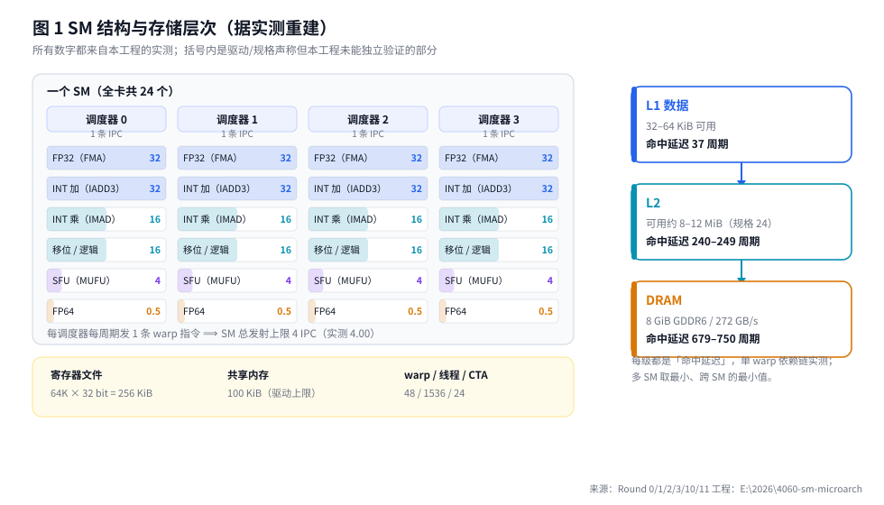

**图 1**：4 个调度器，每个每周期发 1 条 warp 指令，各管 32 个 FP32 lane。
六种流水线宽度不同：FP32 与 INT 加满宽 32，乘/移位/逻辑 16，SFU 4，FP64 只有 0.5（全 SM 2 个）。

### 2.1 怎么证明是 4 个调度器

只增加 warp 数，看 FFMA 吞吐怎么涨（单 CTA、单 SM、每线程 256 条独立 FFMA）：

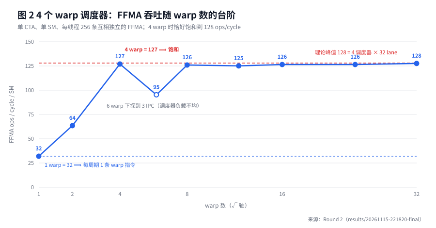

**图 2**：1 warp 给 32 ops/cycle，2 warp 给 63.5，4 warp 给 127——
**严格线性**，每加一个 warp 就多 32。8 warp 以上停在 126±2，不再上涨。

反证两条，都必须能排除：

- 若只有 **2 个**调度器（各 64 lane），1 warp 就该给 64。实测 32 → 排除。
- 若有 **8 个**调度器，8 warp 就该给 256。实测 126 → 排除。

⟹ **4 个调度器，每调度器 1 IPC × 32 lane = 32 ops/cycle，SM 峰值 128。**

### 2.2 没有双发射

混合流（每组 8 条 FFMA + 1 条 LDS + 1 条 LOP）跑 4 个 warp，两组相减：

```
dSASS = 448    dCyc = 448    ⟹  总发射率 = 4.00 条 warp 指令/周期/SM
```

精确卡在 4.00。若存在双发射，FFMA 仍受 128 lane 限制，但 LDS 可以额外挤进 1 条/周期，
总数会到 5 左右。**实测排除了双发射。**

---

## 3. 各流水线的宽度与延迟

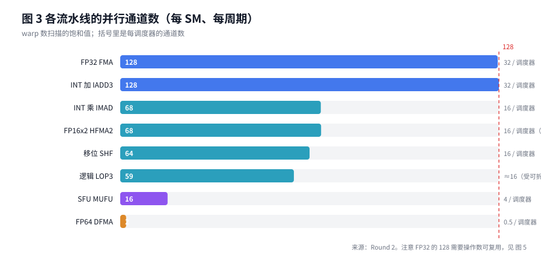

**图 3**：warp 数扫描的饱和值。FP32 与 INT32 加都是满宽 128；
乘、移位、逻辑是半宽 64；SFU 16；FP64 只有 2（正好 1/64）。

几个值得指出的：

- **FP16 不占便宜**。HFMA2 只有 64 条指令/周期，虽然每条算 2 个 FP16，
  合计 128 FLOP/周期——和 FP32 的 128 **完全相同**。FP16x2 只是省一半发射槽，不增加算术吞吐。
- **整数加满宽、整数乘只有半宽**。合理解释是整数加法器复用了 128 个 FP32 加法器，
  而乘/移位/逻辑走每分区 16 个的 ALU 通道。
- **LOP3 只测到 58.7**：逻辑运算的链在数学上无法保持串行（`and`/`or` 幂等、`xor` 自逆），
  ptxas 会消掉一半，剩下的链 ILP 不足。真实值推断为 64。

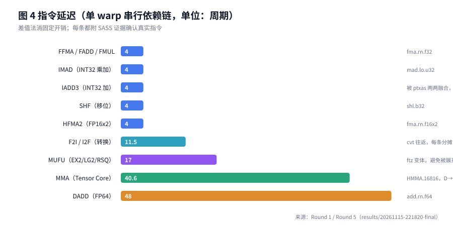

**图 4**：单 warp 串行依赖链测出的延迟。算术指令一律 4 周期；
MUFU 17 周期（因为 SFU 只有 4 通道/调度器，一条 warp 指令要 8 周期流过，再 8 周期回写）；
MMA ≈40；FP64 48。

---

## 4. 「FP32 峰值 128」的前提

这是本工程最重要的一次自我修正。

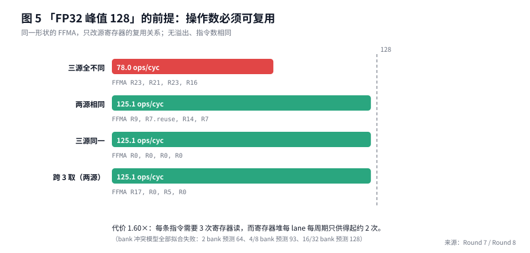

**图 5**：同一形状的 FFMA，只改源寄存器的复用关系。

| 源寄存器模式 | ops/cycle | SASS | `.reuse` 条数 |
|---|---:|---|---:|
| 三源全不同 | **78.0** | `FFMA R23, R21, R23, R16` | 1 / 256 |
| 两源相同 | 125.1 | `FFMA R9, R7.reuse, R14, R7` | 32 / 256 |
| 三源同一 | 125.1 | `FFMA R0, R0, R0, R0` | 0 / 256 |
| 跨 3 取（两源） | 125.1 | `FFMA R17, R0, R5, R0` | 33 / 256 |

已排除的三个替代解释：**无溢出**（`LDL/STL` 为 0，只用 29 个寄存器）、
**指令数相同**（四个变体都恰好 256 条 FFMA）、**不是发射槽限制**（78 远低于 4 IPC 对应的 128）。

代价 1.60×。用 SASS 里全部 224 条 FFMA 的寄存器三元组做统计拟合，试图区分
"读端口不足"与"bank 冲突"：

| 模型 | 预测 ops/cycle | 误差 |
|---|---:|---:|
| 2 bank 冲突 | 64.0 | 18.0% |
| 4 / 8 bank 冲突 | 93.1 | 19.3% |
| 16 / 32 bank 冲突 | 128.0 | 64.1% |
| **每 lane 2 次读（与分布无关）** | **85.3** | **9.4%** |

所有 bank 模型都对不上，唯一接近的是端口模型。**所以证据倾向"寄存器堆每 lane 每周期
供不起 3 次读"，而不是 bank 冲突**——但 9.4% 的残差没解释，仍不能定论。

> 实践含义：真实 GEMM 内层循环满足"操作数可复用"（累加器 + 两个被复用的矩阵元素），
> 所以 128 在实践中可达；但把它当成"任何 FFMA 流都能跑 128"是错的。

---

## 5. 存储层次

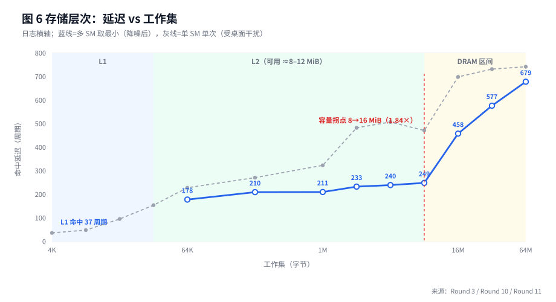

**图 6**：指针追逐测出的延迟曲线。灰线是单 SM 单次测量（受桌面干扰），
蓝线是「多 SM 取最小」（降噪后）。

| 层级 | 容量 | 命中延迟 | 折算 ns @2.74 GHz |
|---|---:|---:|---:|
| 共享内存 | 100 KiB/SM（驱动上限） | 24.0 周期 | 8.8 |
| L1（数据） | 32–64 KiB（单 warp 可用） | **37.0** 周期 | 13.5 |
| L2 | 规格 24 MiB；**可用 8–12 MiB** | **240–249** 周期 | 88–91 |
| DRAM | 8 GiB GDDR6 | **679–750** 周期 | 248–274 |

### 5.1 容量拐点

扫 4/8/16/32/64 MiB（多 SM 取最小）：

```
 4 MiB →  8 MiB:   240 → 249  (1.04×)
 8 MiB → 16 MiB:   249 → 458  (1.84×)   <<< 拐点
16 MiB → 32 MiB:   458 → 577  (1.26×)
32 MiB → 64 MiB:   577 → 679  (1.18×)
```

拐点夹在 **8 与 16 MiB** 之间，而且过了拐点是**命中率渐变**（458 → 577 → 679），
不是干脆失效到 DRAM。推算**可用 L2 约 8–12 MiB**——远小于规格的 24 MiB。

三种可能分不开：桌面长期占用、L2 分为两个 12 MiB 分区而单一地址流没铺满、或大工作集下流式替换。
但就使用者而言结论一样：**在这台同时跑桌面的机器上，一个计算负载能指望的 L2 是 8–12 MiB。**

### 5.2 带宽与 sector

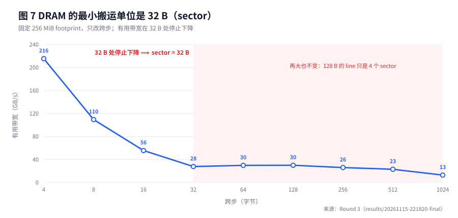

**图 7**：512 MiB 流式读 **250 GB/s**、写 **245 GB/s**（标称 272 的 92%/90%）。
固定 footprint、只改跨步时，有用带宽在 **32 B 处停止下降**——
这是每次未命中的最小搬运单位（**sector = 32 B**）；128 B 的 cache line 只是 4 个 sector 的集合。

### 5.3 共享内存

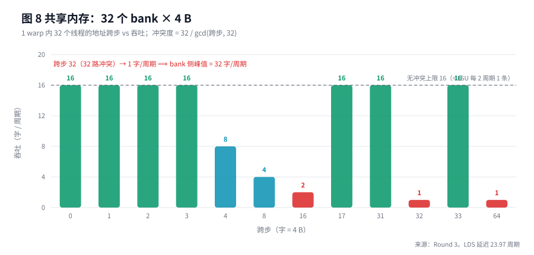

**图 8**：跨步取 4/8/16/32 字时吞吐精确是 8/4/2/1 字/周期，即 `32 / gcd(跨步, 32)`
——没有第二种解释能同时对上这四个点，所以 **bank = 32，宽度 4 B**。

无冲突时只测到 16 字/周期（改用"纯 LDS、零配对加法"的探针复测仍是 16），
说明这是 **LSU 的指令接受率：每 2 周期接受 1 条 LDS 指令**；
bank 侧峰值 32 字/周期（=128 B/周期）是从"32 路冲突给出 1 字/周期"反推的。

LDS 依赖链延迟 **23.97 周期**，比 L1 全局命中的 37 低 13 周期——符合"不经 tag 比较"的预期。

### 5.4 指令缓存（L1I）

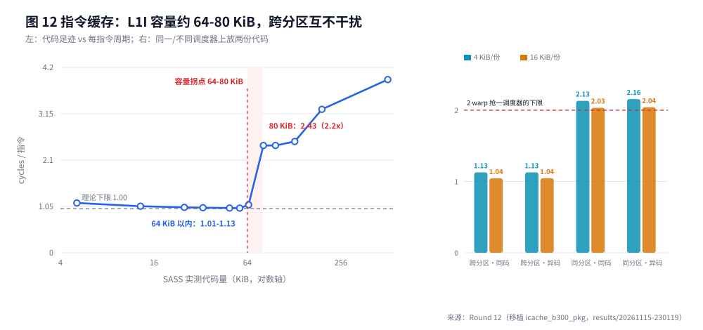

**图 12**：左——代码足迹从 5 KiB 扫到 513 KiB 的每指令周期数；
右——同一/不同调度器上放两份代码。

| SASS 实测代码量 | 每指令周期 |
|---|---:|
| 5–57 KiB | **1.01–1.13** |
| 65 KiB | 1.086 |
| **81 KiB** | **2.431 ← 台阶** |
| 97–129 KiB | 2.43–2.52 |
| 145–193 KiB | 3.10–3.25 |
| 513 KiB | 3.924 |

**L1I 容量 ≈ 64–80 KiB**。容量以内指令供给几乎零开销（1.012 vs 理论下限 1.00），
越界后掉到 2.4 cycles/指令（效率 44%）。

右图是分区归属的证据：warp0 与 warp1（不同调度器）无论跑同代码还是不同代码，
每指令周期**完全不变**；warp0 与 warp4（同一调度器）变成 2.03–2.16——
但那是两个 warp 抢一条发射槽的必然结果（下限 2.0），
因为"同代码"与"不同代码"在这些尺寸下几乎没差别 ⟹ **没有观测到 L0I 容量限制**。

这条数据还解释了一件事：本工程其它所有延迟/吞吐内核都是 ≤16 KiB 的直线代码，
完整装在 L1I 里，所以那些数字不含取指开销。

**容量复核（Round 13）**：自建步进引擎（谓词跳转梯派发）用**稳态差值法**
独立测了一次——压力 53.8 KiB 时碰探针行仍只要 146 周期，**64.5 KiB 时跳到 450**。
两条独立路径都指向"L1I 约 54–64 KiB"。

**取指预取（Round 13）**：让一行必失效后再探邻居——
**+1 行 181 周期（≈命中 165）**、+2 行 254、+3 行 272、+7 行 348（≈失效 344）。
所以存在一个"下一行"预取器，**深度 1 行（128 B）**。这也解释了为什么过容量后是
2.2× 台阶而不是干脆掉到 DRAM 级：顺序执行时下一行总在被预取。


---

## 6. Tensor Core

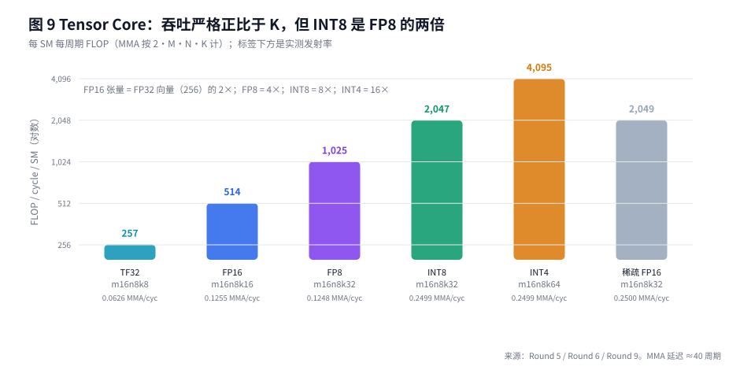

**图 9**：五种精度 + 稀疏的实测吞吐（对数纵轴）。

| 精度 | SASS | 发射率（MMA/cyc） | FLOP/cycle/SM | 延迟 |
|---|---|---:|---:|---:|
| TF32 `m16n8k8` | `HMMA.1688.F32.TF32` | 0.0626 | 257 | 40.9 |
| FP16 `m16n8k16` | `HMMA.16816.F32` | 0.1255 | 514 | 40.6 |
| FP8 `m16n8k32` | `QMMA.16832.F32.E4M3` | 0.1248 | 1025 | 38.8 |
| INT8 `m16n8k32` | `IMMA.16832.S8.S8.SAT` | **0.2499** | **2047** | — |
| INT4 `m16n8k64` | `IMMA.16864.S4.S4.SAT` | 0.2499 | **4095** | — |
| 稀疏 FP16 `m16n8k32` | `HMMA.SP.16832.F32` | 0.2500 | 2049（等效） | — |

三条结论：

1. **吞吐严格正比于 K**。FP16 : TF32 : FP8 = 514 : 257 : 1025 ≈ 1 : 0.5 : 2，
   正好对应 k=16 : 8 : 32。三种精度共用同一条 MMA 流水线。
2. **INT8 是 FP8 的两倍**。同一个 `m16n8k32` 形状、同样 8 位操作数，INT8 发射率 0.2499、
   FP8 只有 0.1248。FP8 路径跑在半速上——**原因未查明**。
3. **稀疏的 2× 在这**：稀疏 MMA 与 dense **同发射率**，但一次覆盖 K=32
   （dense 要两条 `m16n8k16`）。所以对 2:4 稀疏矩阵吞吐是 2×（等效 2049 vs 514）；
   但**有用 FLOP 并不翻倍**（8192 个乘加里一半乘的是零），有效值 515，与 dense 持平。

**`wgmma` 不存在**：`ptxas` 明确拒绝——`Instruction 'wgmma.fence' not supported on .target 'sm_89'`。
第 4 代 Tensor Core 的"新东西"里，FP8 有、Hopper 的 warpgroup MMA 没有。

---

## 7. 全卡扩展性

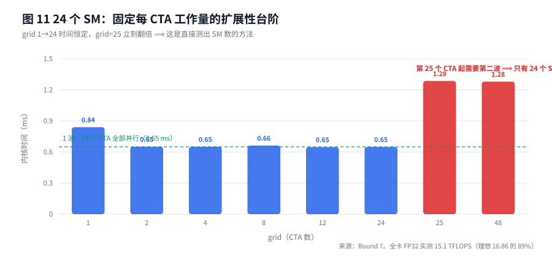

**图 11**：固定每 CTA 的工作量，扫 grid。**grid 1→24 时间完全不变**（0.647–0.662 ms），
**grid=25 立刻翻倍**（1.285 ms）。这是一个非常直接的"数 SM"的方法——**这块卡有 24 个 SM**。

它也验证了本工程一直隐含的假设：「全卡吞吐 = 24 × 单 SM 吞吐」。
实测全卡 FP32 峰值 **15.1 TFLOPS**，理想值 `24 × 128 × 2 × 2.74 GHz = 16.86`，
达成率 **89%**（缺口来自聚合内核的循环控制与单波尾部效应）。

---

## 8. 数据可信度：桌面干扰

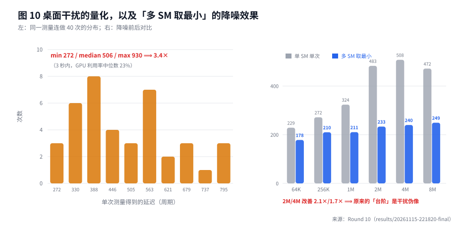

**图 10**：左——同一个 1 MiB 测量连做 40 次（3 秒内），
`min=272 / median=506 / max=930`，**max/min = 3.4×**；
右——降噪前后对比。

这是本工程最需要交代的一件事：**单次测量的绝对值没有意义，只有 min 有意义。**
中位数比真值高 86%，这既解释了早期"同一尺寸两次运行差 35%"，也解释了
一个曾经看起来像"2–8 MiB 有一级额外缓存"的伪台阶。

降噪方法：24 个 CTA（每 SM 一个）**共读同一区域**、各从不同节点起跑一条独立链，
取跨 SM 的最小值——被干扰最少的那个 SM 的读数。改善 1.2–2.1×，
2/4 MiB 的伪台阶被完全消除。

**为什么不能独占**：本机 `i5-13490F` 是 **F 型号（无核显）**，系统里只有 RTX 4060 一张显示适配器，
两块显示器都接在它上面。要做到真正独占需要**加一张亮机卡**接显示器，
让 4060 变成纯计算卡。在那之前，多 SM 取最小是最优替代方案。

---

## 9. 与公开规格的对照

| 项 | 公开说法 | 本工程实测 | 一致性 |
|---|---|---|---|
| SM 数 | 24 | 24（驱动 + `%nsmid` + `%smid` + CTA 阶梯四方印证） | ✅ |
| CUDA core | 3072 = 24×128 | FP32 峰值 127.6 ops/cyc/SM | ✅ |
| warp 宽度 / 每 SM warp | 32 / 48 | 32 / 48 | ✅ |
| 寄存器 / SM | 64K | 65,536 | ✅ |
| 共享内存 / SM | 100 KiB | 100 KiB | ✅ |
| L2 | 24 MiB | 拐点 8–16 MiB，**可用仅 8–12 MiB** | ⚠️ 规格与实际可用量不同 |
| FP64 : FP32 | 1 : 64 | 2 : 127.6 ≈ 1 : 64 | ✅ |
| FP16 非张量 = FP32 | 是 | 128 : 128 | ✅ |
| 调度器数 | 未公开 | **4**（warp 阶梯 + 每 warp 计时） | ✅ 实测补充 |
| SFU 数 | 未公开 | **16/SM** | ✅ 实测补充 |
| 公开的 2× 稀疏 | 2× | 等效 2×，有用 FLOP 不翻倍 | ✅ 但需看清口径 |
| INT8 vs FP8 | 同形状同吞吐（一般预期） | **INT8 是 FP8 的 2×** | ⚠️ 反常 |
| FP32 峰值 | 128/SM | 128（可复用）/ **78**（全不同源） | ⚠️ 需看前提 |

---

## 10. 明确未验证的清单

这些都是**不能当结论**的：

1. **L2 容量精确值**：只能夹在 8–16 MiB 之间（链构造要求节点数是 2 的幂）。
2. **L1 精确容量**：只有 32–64 KiB 的区间。
3. **78 的机制**：倾向"每 lane 2 次读"的端口限制，但 9.4% 残差未解释；
   无法区分读端口与 bank 冲突（需要固定物理寄存器号）。
4. **FP8 为何只有 INT8 一半发射率**：只观察到现象，机制未知。
5. **warp→调度器的定量映射**：定性确认是"共享调度器"，但 per-warp 时间戳不可定量
   （各 warp IPC 之和 4.51 > 实测上限 4.00）。
6. **共享内存 bank 侧峰值 32 字/周期**：反推值，未直接测到。
7. **TLB 容量**：只证明 256 页 × 2 MiB（512 MiB 跨度）内零代价，再往上受显存限制。
8. **LOP3 精确吞吐**：58.7 受折叠污染，推断 64。
9. **L1I 只测了容量**：延迟、取指带宽（每周期多少字节）、行大小、组相联、替换策略都没测；
   L0I 是否存在也未确定（只能说 2 × 16 KiB 规模上没有容量限制）。
10. **未测**：`cp.async`/LDGSTS、常量/纹理路径、原子单元、DPX、64 KiB 页、
    MMA 与向量指令的并发、多 CTA 聚合张量吞吐、INT8/INT4 延迟、稀疏的其它形状。

---

## 11. 复现

```powershell
cd E:\2026\4060-sm-microarch
.\.venv\Scripts\python.exe smoke.py            # 链路自检：编译 -> 加载 -> 启动 -> SASS
.\.venv\Scripts\python.exe run_all.py          # 全部 11 轮，约 12 分钟
.\.venv\Scripts\python.exe run_all.py --round 3 --tag mem
.\.venv\Scripts\python.exe docs\figures\make_figures.py   # 重新生成全部 SVG
```

结果落到 `results/<时间戳>[-tag]/`，含 `run.log`（人读）与 `results.json`（机读，
含每条结论的原始数值与 SASS 证据行）。

```
harness/    测量框架（纯 ctypes，无第三方依赖）
  cuda.py   驱动 API + NVRTC 绑定
  env.py    DLL 路径、设备属性、显存
  jit.py    NVRTC 编译、模块加载、cuobjdump/nvdisasm 反汇编
  bench.py  周期计时、预热、差值法
probes/     12 个探针（round0..round12），每个暴露 run(log, reps) -> dict
third_party/icache_b300_pkg/  外部 L1I 测试包（Round 12 复用其内核生成器）
docs/       13 篇分析文档 + 本报告 + figures/（SVG 生成脚本与输出）
notes/      inference-log.md：40 条结论的完整证据链
```

---

## 附录 A：踩过的坑（每条都曾让数据失真）

| 坑 | 现象 | 对策 |
|---|---|---|
| 常量输入被折叠 | 延迟测出 **0**（`a+=1`×320 被折成一条 `IADD3`） | 操作数一律从显存读 |
| 代数化简 | `xor` 自逆、`and` 幂等、`rcp∘rcp` 恒等 → `dSASS=0` | 换不可化简形式 |
| 指令融合 | `add.u32`×320 → 160 条 `IADD3` | 按 `cyc/SASS` 归一 |
| 指令替换 | `fma.rn.f16x2` 第三源为 0 → 变成 `HADD2` | 第三源取运行时值 |
| 非 ftz 的 MUFU 被展开 | `rcp/lg2/rsqrt.approx.f32` → 4~7 条指令 | 用 `.ftz` 变体 |
| sink 只引用部分累加器 | 其余链被当死代码删，测到的是延迟不是吞吐 | sink 消费全部累加器 |
| 重复访存被合并/删除 | 128 条相同 `ld.shared` → 只剩 1 条 | 每条结果都要消费 + SASS 校验 |
| 按"总指令数"归一 | Tensor 吞吐高估 1.5×（768 vs 真实 512） | 计数精确到指令类别 |
| 常量初始化让源变立即数 | `FFMA R7, R0, R7, 0.5`，"三源全不同"实验失效 | 源从显存读 |
| SASS 取样取到初始化代码 | 取到的是 `bv + k*0.5f` 的编译结果 | 取函数**中段**的指令 |
| 跳数不足 | 大 footprint 全塌到同一延迟（"DRAM 跟 L2 一样快"） | 跳数 ≥ 4 × footprint/128B |
| 等步长环别名 | 32 KiB 延迟比 64 KiB 还高 | 编号域整环 + 地址域双射模糊 |
| `min` 撞上坏点 | ops/cyc 出现 384、2621、52428 | 吞吐用中位数 + 物理上限过滤 |
| PowerShell 改写文件 | 中文变乱码（按 ANSI 解码） | 只用编辑工具，不用 pwsh 读写 |
| 桌面干扰 | 同一次测量 3 秒内差 3.4× | 一律取 min；关键实验用多 SM 取最小 |

## 附录 B：证据链索引

完整记录在 `notes/inference-log.md`，每条格式为
**结论 → 测量 → SASS 证据 → 反证 → 置信度**。

| 编号 | 结论 | 置信度 |
|---|---|---|
| L01–L03 | SM 数 24、warp 32/48、4 个调度器 | 高 |
| L04–L07 | 发射上限 128、SFU 16、FP64 2、FP16 = FP32 | 高 |
| L08–L09 | INT 加 128 / 乘 64；FP32+INT32 未表现并发 | 中 |
| L10–L13 | 指令延迟 4/11.5/17/48；ptxas 融合；LOP3 测不准；主频 2.74 GHz | 高 |
| L14–L23 | 存储层次：L1 37、L2 230–265、DRAM 745、带宽 250、sector 32、smem 32 bank、LDS 24 | 高 |
| L21–L23 | 总发射 4.00 IPC、无双发射；6-warp 低谷=负载不均；LDS 接受率 | 高 |
| L24–L26 | Tensor 正比于 K；每调度器 128 FLOP；"数所有指令"的教训 | 高 |
| L27–L29 | 稀疏同发射率；warp 同步启动；per-warp 计时不可定量 | 高 |
| L30–L33 | 三源全不同 78；24 SM 与 15.1 TFLOPS；warp 无节流；bank 拟合倾向端口 | 高/中 |
| L34–L38 | INT8 = 2× FP8；TLB 无代价；干扰 3.4×；降噪消除伪台阶；L2 拐点 8–16 MiB | 高 |
| L39–L40 | L1I 容量 64–80 KiB（越界 2.2× 台阶）；跨调度器分区互不干扰、无 L0I 容量限制 | 高 |
